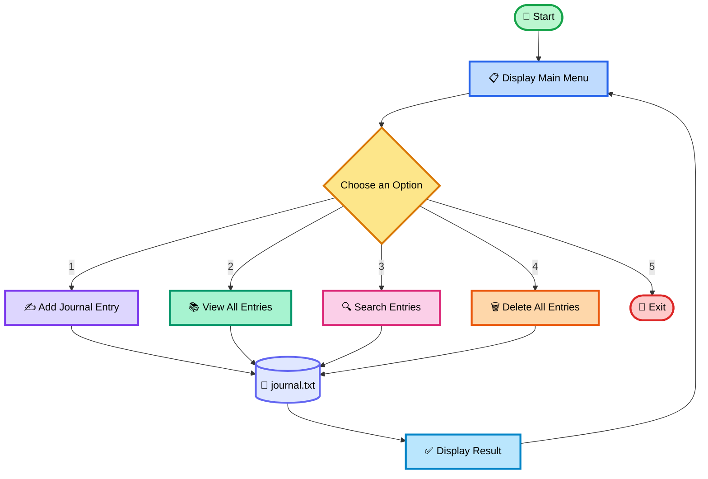
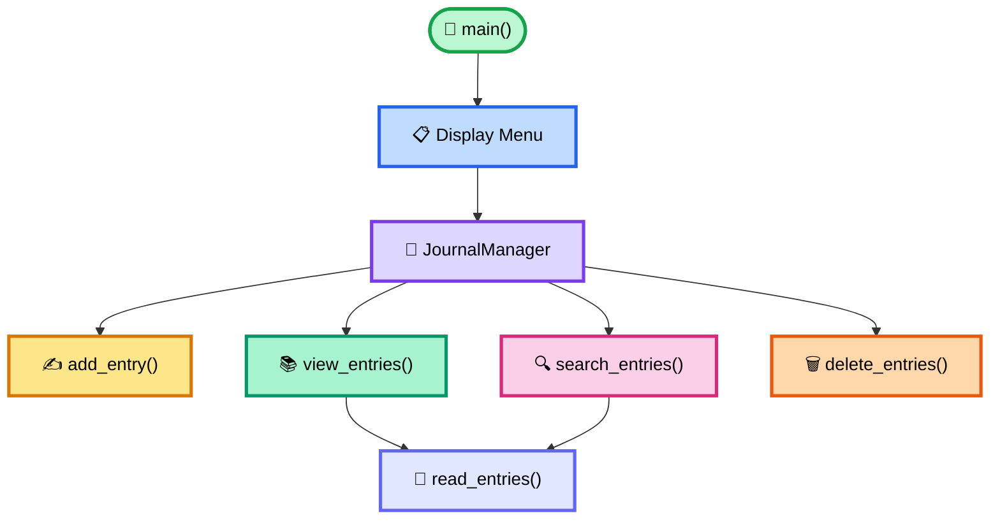

<div align="center">


<br>

<h3>✨ A Python File-Handling &amp; OOP Project ✨</h3>

<br>


</div>
<hr>
## 📚 Table of Contents

- [🌟 Project Overview](#-project-overview)
- [✨ Features](#-features)
- [🧰 Concepts Used](#-concepts-used)
- [🔄 Program Flowchart](#-program-flowchart)
- [🏗️ Class and Method Structure](#️-class-and-method-structure)
- [🧠 Code Explanation](#-code-explanation)
- [🖥️ Actual Sample Output](#️-actual-sample-output)
- [📸 Screenshot](#-screenshot)
- [🎬 Project Demo Video](#-project-demo-video)
- [🛠️ Technologies](#️-technologies)
- [📁 Project Structure](#-project-structure)
- [🚀 Future Improvements](#-future-improvements)
- [🎯 Learning Outcomes](#-learning-outcomes)
- [👩‍💻 Author](#-author)

---

## 🌟 Project Overview

**Personal Journal Manager** is a command-line Python application for recording and managing personal journal entries. Each entry is saved with the date and time it was created, and the application provides menu options to view entries, search for a keyword or date, and delete all saved entries.

The project uses a `JournalManager` class to keep related operations organized. It is designed to practise Python fundamentals such as **file handling, classes and objects, exception handling, string processing, list comprehension, date/time formatting, and `match-case`**.

---

## ✨ Features

| Feature | How it works |
|---|---|
| ✍️ **Add a New Entry** | Accepts non-empty text, adds a timestamp, and appends it to the journal file |
| 📚 **View All Entries** | Reads saved entries and displays them in the terminal |
| 🔎 **Search for an Entry** | Searches entry contents using a keyword or date without case sensitivity |
| 🗑️ **Delete All Entries** | Asks for confirmation before removing the journal file |
| 🕒 **Automatic Timestamp** | Uses `datetime.now()` to record the current date and time |
| 🛡️ **File Error Handling** | Handles missing-file, permission, and other OS errors in relevant operations |
| 🚫 **Input Validation** | Rejects blank journal entries and blank search terms |
| 🔁 **Menu Loop** | Keeps showing the menu until the user chooses Exit |

---

## 🧰 Concepts Used

- **Object-Oriented Programming:** `JournalManager` groups journal-related data and methods.
- **File handling:** `open()` reads saved data and appends new entries.
- **Exception handling:** `try`, `except`, `FileNotFoundError`, `PermissionError`, and `OSError`.
- **Date and time:** `datetime.now().strftime()` creates a readable timestamp.
- **String methods:** `strip()` removes surrounding whitespace; `casefold()` supports case-insensitive matching.
- **List comprehension:** Builds the list of entries and filters search matches.
- **Control flow:** `while`, `if`, and `match-case` control program execution.
- **OS module:** `os.path.exists()` checks for the file and `os.remove()` deletes it.
- **Context manager:** `with open(...)` closes a file automatically after its block.

---

## 🔄 Program Flowchart


### What the flow shows

1. The program starts and displays the menu.
2. The user chooses one of five operations.
3. Options 1–4 perform the selected journal action and return to the menu.
4. Option 5 prints the goodbye message and ends the program.

---

## 🏗️ Class and Method Structure


### `JournalManager` class

| Method | Responsibility |
|---|---|
| `__init__(filename="journal.txt")` | Stores the filename to use for journal data |
| `read_entries()` | Reads file content and separates entries using blank lines |
| `add_entry()` | Collects the user's text, adds a timestamp, and appends the entry |
| `view_entries()` | Displays saved entries or an appropriate message |
| `search_entries()` | Finds entries containing the entered keyword or date |
| `delete_entries()` | Requests confirmation and removes the journal file |

### `main()` function

The `main()` function creates a `JournalManager` object, prints the menu in a loop, routes the selected option to the corresponding method, and exits when the user selects option 5. It also handles `KeyboardInterrupt` and `EOFError` so the program can stop gracefully in those cases.

---

## 🧠 Code Explanation

### 1. Creating the manager object

```python
journal = JournalManager()
```

This creates an instance of `JournalManager`. Since no filename is passed, the class uses its default filename, `journal.txt`.

### 2. Creating a timestamp

```python
timestamp = datetime.now().strftime("%Y-%m-%d %H:%M:%S")
```

- `datetime.now()` gets the current local date and time.
- `strftime()` formats it as `year-month-day hour:minute:second`.

### 3. Saving an entry safely

```python
with open(self.filename, "a", encoding="utf-8") as file:
    file.write(entry)
```

Append mode (`"a"`) adds the new entry to the end of the file instead of replacing older entries. The `with` statement closes the file automatically when the block finishes.

### 4. Reading entries from the file

```python
content = file.read()
return [entry for entry in content.strip().split("\n\n") if entry.strip()]
```

The application separates entries at blank lines. The list comprehension excludes any empty sections.

### 5. Searching for a keyword

```python
matches = [
    entry for entry in entries
    if keyword.casefold() in entry.casefold()
]
```

`casefold()` makes matching case-insensitive for typical text searches. Since timestamps are part of each entry, searching for a date can also find entries from that date.

### 6. Handling file errors

The code handles common file-related problems, such as a missing file, denied permissions, and other operating-system errors. These exceptions let the program show understandable messages rather than exposing a raw traceback for those expected cases.

### 7. Using `match-case`

The menu uses Python's `match-case` statement to route each string choice to the correct method. This syntax requires **Python 3.10 or newer**.

---

## 🖥️ Actual Sample Output

```text
Welcome to Personal Journal Manager!

Please select an option:
1. Add a New Entry
2. View All Entries
3. Search for an Entry
4. Delete All Entries
5. Exit

Enter your choice: 1

Enter your journal entry: Today was a normal day, but I'm grateful for the little things that made me smile.

Entry added successfully!

Please select an option:
1. Add a New Entry
2. View All Entries
3. Search for an Entry
4. Delete All Entries
5. Exit

Enter your choice: 2

Your Journal Entries:
----------------------------------------
[2026-10-12 16:08:00]
Today was a normal day, but I'm grateful for the little things that made me smile.


Please select an option:
1. Add a New Entry
2. View All Entries
3. Search for an Entry
4. Delete All Entries
5. Exit

Enter your choice: 3

Enter a keyword or date to search: grateful

Matching Entries:
----------------------------------------
[2026-10-12 16:08:00]
Today was a normal day, but I'm grateful for the little things that made me smile.


Please select an option:
1. Add a New Entry
2. View All Entries
3. Search for an Entry
4. Delete All Entries
5. Exit

Enter your choice: 4

Are you sure you want to delete all entries? (yes/no): yes

All journal entries have been deleted.

Please select an option:
1. Add a New Entry
2. View All Entries
3. Search for an Entry
4. Delete All Entries
5. Exit

Enter your choice: 5

Thank you for using Personal Journal Manager. Goodbye!
```

---

## 📸 Screenshot
()

```html
```

---

## 🎬 Project Demo Video
(https://github.com/user-attachments/assets/34db55df-3153-472b-acb8-0fa16e3ccd54)

---

## 🛠️ Technologies

| Technology | Purpose |
|---|---|
| **Python 3.10+** | Main programming language; supports `match-case` |
| **`datetime`** | Generates entry timestamps |
| **`os`** | Checks for and removes the journal file |
| **Text file (`journal.txt`)** | Stores entries locally |
| **GitHub** | Hosts source code, README, and flowchart images |

---

---

## 📁 Project Structure

```text
Personal-Journal-Manager/
├── main.py
├── README.md
├── journal.txt                  # Created when an entry is saved
└── assets/
    ├── program_flowchart.png
    ├── class_structure.png
    └── journal_output.png       # Add your screenshot here
```

---

## 🚀 Future Improvements

- 🔐 Add a password or encryption for privacy.
- ✏️ Add options to edit or delete a single entry.
- 🏷️ Add tags, moods, or categories.
- 📅 Filter entries by date.
- 💾 Store entries in SQLite.
- 📤 Add export, backup, and restore features.
- 🖥️ Build a graphical interface using Tkinter.
- 🔎 Separate date filtering from keyword search.

---

## 🎯 Learning Outcomes

By building this project, I practised:

- Organizing functionality with a Python class.
- Creating and calling object methods.
- Reading and appending text files.
- Formatting timestamps.
- Splitting text and filtering lists.
- Searching strings without case sensitivity.
- Handling file and permission exceptions.
- Validating user input.
- Using `while` and `match-case` for a menu.
- Checking and deleting files using the `os` module.

---

## 📌 Project Information

| Detail | Information |
|---|---|
| **Project Name** | Personal Journal Manager |
| **Language** | Python |
| **Required Version** | Python 3.10+ |
| **Project Type** | Console-based mini project |
| **Main Topics** | File Handling, OOP, Exception Handling |
| **Storage** | Local text file |

---

<div align="center">

## 👩‍💻 Author

**DHARA**

*Python • File Handling • Learning by Building*

⭐ **If you find this project useful, consider starring the repository!**

</div>
